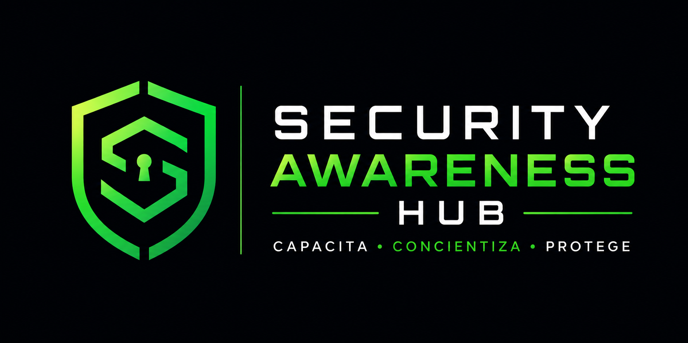

<p align="center">
  
</p>

## 📌 Descripción

**Security Awareness Hub** es una plataforma web orientada a organizaciones que buscan fortalecer la cultura de ciberseguridad de sus colaboradores.

La plataforma nace como respuesta a la necesidad de mejorar la preparación de los empleados frente a amenazas digitales como **phishing, ingeniería social, malware, robo de credenciales y malas prácticas en el manejo de información**.

El proyecto busca centralizar los procesos de capacitación y concientización en ciberseguridad dentro de una organización, permitiendo gestionar usuarios, roles y contenidos educativos desde un mismo entorno.

Security Awareness Hub está diseñado para representar una solución aplicable a un entorno empresarial real, donde los administradores puedan gestionar la plataforma y los colaboradores puedan acceder a procesos de formación que les permitan identificar, prevenir y reportar posibles amenazas de seguridad.

La primera versión del proyecto estará enfocada en la construcción de un **MVP (Producto Mínimo Viable)** compuesto por las funcionalidades fundamentales de la plataforma:

- 🔐 Sistema de inicio de sesión.
- 🏢 Registro de empresas.
- 👤 Registro y gestión de usuarios.
- 🛡️ Gestión de roles y permisos.

Posteriormente, la plataforma podrá evolucionar con funcionalidades como cursos de capacitación, evaluaciones, reportes de phishing, estadísticas, seguimiento del progreso y generación de certificados.

> **Capacita · Concientiza · Protege**

## ☕ Versión Spring Boot (`backend/spring-boot`)

La migración a **Java 21 + Spring Boot 4** (API REST + páginas Thymeleaf con el CSS del frontend + MariaDB) reemplaza al backend PHP.

| Módulo | Qué permite |
|---|---|
| Cursos, evaluaciones, empresas, usuarios | CRUD con validación, roles y desactivación (sin borrado) |
| Carga masiva por CSV | Registrar estudiantes desde un archivo; cada uno recibe su contraseña temporal por correo |
| Asignaciones | Asignar cursos o evaluaciones; aviso por correo; el estudiante registra su avance |
| Reportes | Avance por curso, por empresa y por estudiante |

**Ejecutar** (XAMPP con MariaDB encendido):

```powershell
# Importar en phpMyAdmin, en orden:
#   database/security_awareness_hub.sql
#   database/migracion_001_roles_empresas_asignaciones.sql
#   database/crear_usuario_app.sql        (cambia antes la clave)
cd backend\spring-boot
copy .env.example .env                  # escribe DB_PASSWORD
.\mvnw.cmd clean test                   # 49 pruebas
.\mvnw.cmd spring-boot:run              # http://localhost:8080
```

**Documentación:**
[decisiones de la migración](docs/migracion-decisiones.md) ·
[API REST y pruebas](docs/evidencias/api/README.md) ·
[Sesión 6](docs/evidencias/sesion-6-persistencia.md) ·
[Sesión 8](docs/evidencias/sesion-8-correo-csv.md) ·
[hallazgos y riesgos](docs/calidad/hallazgos-y-riesgos.md) ·
[Lista de Chequeo 5](docs/lista-chequeo-5.md)

## 🗂️ Estructura del repositorio

```
backend/spring-boot/        Aplicación Java (Spring Boot)
├── src/main/java/com/sah/
│   ├── config/             SecurityConfig, DatosIniciales
│   ├── controller/api/     API REST (/api/**, HTTP Basic, Postman)
│   ├── controller/web/     Páginas (@Controller + Thymeleaf)
│   ├── service/            Reglas de negocio
│   ├── repository/  model/  dto/  exception/  notificacion/
├── src/main/resources/templates/   Vistas HTML (Thymeleaf)
└── src/test/               49 pruebas automáticas
frontend/                   Diseño: CSS, imágenes y landing (los usa la app Java)
├── Interface_Administrador/css/    Estilos del panel
├── authentication/css, assets/     Estilos e imágenes del login
└── Landing_Page/                   Página pública y contenido del curso
database/                   Scripts SQL y herramienta restablecer_clave.php
docs/                       Decisiones, evidencias, calidad y lista de chequeo
```

Los CSS de `frontend/` son la **única fuente de estilos**: Maven los copia a la aplicación al compilar.

## 🕘 Versión PHP (retirada)

La primera versión del backend era MVC en PHP puro (`backend/Api`, `Controllers`, `Models`, `Core`) con páginas PHP en `frontend/`.
Se retiró el 2026-11-28 porque Spring Boot ya cubre todas sus funciones (ver D21 en [docs/migracion-decisiones.md](docs/migracion-decisiones.md)).
Su código sigue disponible en el historial de Git (commit `50104ee` y anteriores).
